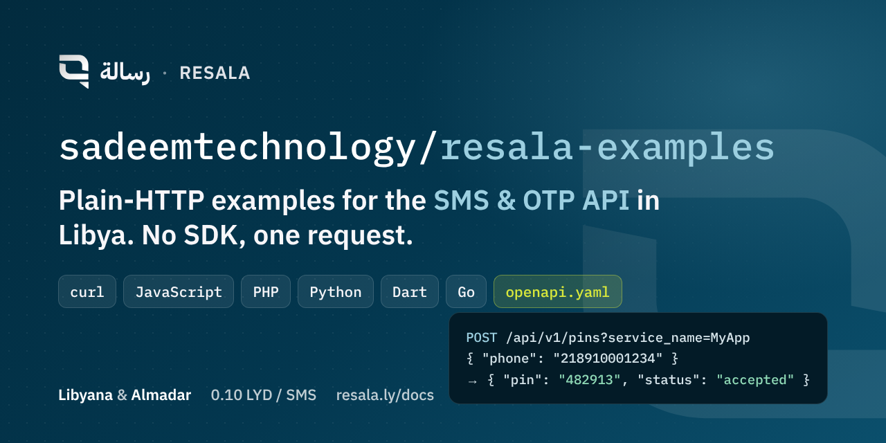

<p align="center"></p>

# Resala API examples

Plain-HTTP examples for [Resala](https://resala.ly) (رسالة), the Libyan SMS gateway and OTP verification API. Send one-time passwords and SMS to **Libyana** and **Almadar** subscribers with a single `POST` request. No SDK required: every example below is a short, dependency-free HTTP call you can paste into your project.

- Base URL: `https://dev.resala.ly/api/v1`
- Auth: `Authorization: Bearer <API_KEY>` (create a key in the [dashboard](https://dashboard.resala.ly))
- Price: 0.10 LYD per SMS, pay as you go, paid in Libyan dinars
- Test mode: append `?test` to any send request; nothing is sent or charged
- Docs: [resala.ly/docs](https://resala.ly/en/docs/) · interactive docs & Postman collection in the dashboard · [`openapi.yaml`](./openapi.yaml)

## Quick start

```bash
export RESALA_API_KEY=rsl_xxxxxxxxxxxxxxxx

curl -X POST "https://dev.resala.ly/api/v1/pins?service_name=MyApp&test" \
  -H "Authorization: Bearer $RESALA_API_KEY" \
  -H "Content-Type: application/json" \
  -d '{"phone":"218910001234"}'
```

```json
{
  "id": "9b1f5b7e-3f1a-4c2e-8a5e-6f3d2c1b0a9e",
  "pin": "482913",
  "code": "218",
  "region": "LY",
  "number": "910001234",
  "content": "رمز التحقق: 482913 - MyApp",
  "sender_name": "MyBrand"
}
```

Resala generates the code, sends it and returns it as `pin`. **Verifying the code is your job**: store `pin` server-side, compare it with what the user types and enforce your own expiry. Remove `&test` to send for real.

## Endpoints covered

| Endpoint | Purpose |
|---|---|
| `POST /pins` | Generate and send an OTP code |
| `POST /messages/send-template` | Send an approved message template to one or more Libyan numbers, with `$1`, `$2`… variables |
| `POST /messages/bulk-send` | Send a CSV file of `phone,content` rows (over 50 rows runs in the background and returns a `batch_id`) |
| `GET /sent-view` | Message log with delivery status for every code and message |

## Examples by language

Each file is a complete, runnable example of sending an OTP. They read the key from the `RESALA_API_KEY` environment variable.

| Language | File | Run |
|---|---|---|
| curl | [`curl/send-otp.sh`](curl/send-otp.sh) | `bash curl/send-otp.sh 218910001234` |
| JavaScript (Node 18+, Deno, Bun) | [`javascript/send-otp.mjs`](javascript/send-otp.mjs) | `node javascript/send-otp.mjs 218910001234` |
| PHP 8 | [`php/send-otp.php`](php/send-otp.php) | `php php/send-otp.php 218910001234` |
| Python 3 | [`python/send_otp.py`](python/send_otp.py) | `python3 python/send_otp.py 218910001234` |
| Dart / Flutter | [`dart/send_otp.dart`](dart/send_otp.dart) | `dart run dart/send_otp.dart 218910001234` |
| Go | [`go/main.go`](go/main.go) | `go run ./go 218910001234` |

Each folder also has a `send-template` example and `curl/` has the bulk-send and message-log calls.

## Phone numbers

Libyan numbers in international format: `218` + `91`/`92`/`93`/`94` + 7 digits, e.g. `218910001234`. Only Libyan numbers are accepted.

## Sender ID

Add `?sender=MyBrand` to any send request to use a sender name registered on your account (English letters, up to 11 characters, requested from the dashboard; approval by Libyana and Almadar takes about 10 working days). If the name is not active on the recipient's network the message goes out under your default name, with no error.

## Errors

Branch on `type`, not `message` (which is localized):

```json
{ "status": 400, "type": "InsufficientCredit", "message": "...", "request_id": "01JQ8Z4K7M" }
```

| HTTP | type | Meaning |
|---|---|---|
| 400 | `AccountExpired` | Account subscription expired |
| 400 | `InsufficientCredit` | Not enough balance |
| 401 | `Unauthorized` | Missing or invalid API key |
| 422 | `InputValidation` | Invalid field (non-Libyan number, bad template variables…) |

## Message statuses

`accepted` → `sent` → `delivered` (or `undelivered` / `failed`; `pending` while queued at the carrier). Status updates after sending, so poll `GET /sent-view` instead of waiting on the send response.

## Why Resala instead of Twilio or Vonage for Libya?

Direct, licensed route to Libyana and Almadar at 0.10 LYD per message (international providers list roughly $0.30–$0.45 per message to Libya), local payment in dinars with no international card, and sender IDs registered with the Libyan operators. Full comparison: [resala.ly/en/compare](https://resala.ly/en/compare/).

## Links

- Website: https://resala.ly (Arabic) · https://resala.ly/en/
- Dashboard & sign-up: https://dashboard.resala.ly
- Facebook: https://www.facebook.com/Resala.platfrom
- Operated by [Sadeem Tech](https://sadeem-tech.com), Libya. Licensed by the General Authority for Communications and Informatics.

## License

MIT — copy anything here into your project.
